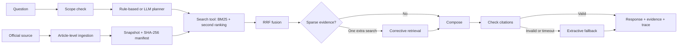

# Consumidor RAG · Argentina

English · [Documentación en español](README.md)

[](https://github.com/andresListorti/RAG/actions/workflows/ci.yml)

**Auditable retrieval over Argentina's Consumer Protection Act, with verbatim citations, hybrid search and a bounded agent workflow.**

A portfolio project demonstrating practical RAG engineering: reproducible ingestion, measurable retrieval, tool orchestration, evidence-grounded generation and security controls. The application and legal responses are in Argentine Spanish. This document explains the project in English for reviewers and recruiters.

> Educational demo, not legal advice. Act 24,240 is part of a broader legal framework. The corpus excludes case law, civil codes, regulations and provincial procedures. Always check the official source, current legislation and professional advice when needed.

## Quick start

Requirements: Python 3.13 and [uv](https://docs.astral.sh/uv/). The default demo needs no API keys or model downloads.

```bash
git clone https://github.com/andresListorti/RAG.git
cd RAG
uv sync --frozen
uv run uvicorn consumidor.api:app --app-dir src --host 127.0.0.1 --port 8000
```

Open **http://127.0.0.1:8000**. A versioned corpus snapshot is included. Installing dependencies requires internet; subsequent extractive queries make no external API calls.

```bash
curl http://127.0.0.1:8000/health
curl -X POST http://127.0.0.1:8000/api/ask \
  -H 'Content-Type: application/json' \
  -d '{"question":"¿Qué garantía legal tiene un producto nuevo?"}'
```

PowerShell equivalent:

```powershell
Invoke-RestMethod http://127.0.0.1:8000/api/ask -Method Post -ContentType 'application/json; charset=utf-8' -Body '{"question":"¿Qué garantía legal tiene un producto nuevo?"}'
```

## Engineering capabilities

| Capability | Implementation |
|---|---|
| Traceable ingestion | Allowlisted official URL, UTC retrieval date, source and corpus SHA-256, structural checks |
| Legal chunking | One block per article, preserving bis/ter/quáter numbering and amendment notes |
| Hybrid retrieval | BM25 + character TF-IDF by default; optional BM25 + multilingual neural embeddings |
| Ranking | Reciprocal Rank Fusion, explicit article lookup and multi-query result fusion |
| Agent workflow | Planner → search tool → bounded corrective retrieval → composition → citation validation |
| Grounding | Retrieved document ID plus an exact quote; extractive fallback on errors |
| Observability | Executed queries, step outcomes, evidence IDs, backend, latency and corpus version |
| Evaluation | Versioned dataset, Hit@5, MRR@5, out-of-scope abstention and automated regression tests |
| Security | No execution tools, no unrestricted browsing, environment-based secrets, resource limits and safe DOM output |

## Architecture



The default mode uses rule-based planning and verbatim excerpts. **It is an offline retrieval and extractive-composition baseline, not a demonstration of LLM reasoning.** In LLM mode, a model chooses search queries and writes explanations; the application controls tool execution and budgets. The workflow is implemented directly in Python so its transitions remain explicit and testable.

Per-question limits: up to 3 planned searches, 1 corrective search, 5 articles and 2 LLM calls, each with a 1,500-output-token budget and a 25-second socket timeout. Traces describe observable actions, not private chains of thought.

## Execution modes

### Offline baseline

BM25 and character TF-IDF with 3–5 character n-grams, fused using RRF. Both rankings are **lexical**, not neural semantic embeddings. Responses display retrieved passages rather than generated legal interpretations.

### Optional multilingual embeddings

```bash
uv sync --frozen --extra semantic
export EMBEDDING_MODEL=sentence-transformers/paraphrase-multilingual-MiniLM-L12-v2
```

In PowerShell:

```powershell
$env:EMBEDDING_MODEL='sentence-transformers/paraphrase-multilingual-MiniLM-L12-v2'
```

Restart the server with that environment variable. The second ranking becomes cosine similarity over normalized multilingual embeddings; BM25 and RRF remain. The first startup downloads the model and may require several hundred MB. Remote model code is disabled with `trust_remote_code=False`. Review provenance and licensing before changing the model.

The index stays in memory because this corpus contains only 75 blocks. Long articles can exceed the neural encoder's input window; BM25 still reads their full text. A larger corpus would benefit from subsection chunks, parent-article retrieval and index persistence. The published baseline does not measure this optional backend.

### LLM planning and generation

Configure a Chat Completions-compatible provider supporting `response_format=json_object`:

```powershell
$env:GENERATION_BACKEND='llm'
$env:LLM_BASE_URL='https://api.openai.com/v1'
$env:LLM_MODEL='<model-available-from-your-provider>'
$env:LLM_API_KEY='<your-key>'
uv run uvicorn consumidor.api:app --app-dir src --host 127.0.0.1 --port 8000
```

Use `export NAME=value` in bash. `.env.example` documents the variables; it is **not automatically loaded**. Never commit credentials. The browser never receives the API key. LLM mode sends the question and legal evidence to the configured provider and may incur costs. Do not enter personal information.

Invalid plans, timeouts and nonexistent quotes trigger an extractive response with `fallback=true`. Citation validation establishes **textual provenance**, not logical entailment between a generated statement and its quote. Human review remains necessary. LLM behavior is tested with controlled test doubles; no paid provider was used to validate this release.

## Corpus provenance and refresh

Source: [official updated text of Act 24,240](https://www.argentina.gob.ar/normativa/nacional/ley-24240-638/actualizacion). Snapshot retrieved on **November 14, 2026**, with 75 article blocks. Exact metadata is in [data/manifest.json](data/manifest.json).

The official page contains two articles numbered 66 and explicitly documents the duplication. Both are preserved as `66` and `66 cierre`, with distinct IDs. Navigation and historical amendments listed after the law are excluded. Amendment notes embedded in articles remain part of the text; this is not a complete history of the legislation.

```bash
PYTHONPATH=src uv run python -m consumidor.ingest
PYTHONPATH=src uv run python -m consumidor.evaluate --output evals/latest.json
```

PowerShell:

```powershell
$env:PYTHONPATH='src'
uv run python -m consumidor.ingest
uv run python -m consumidor.evaluate --output evals/latest.json
```

Review corpus changes and evaluation results before committing an update. Ingestion fails on unexpected structure or duplicate numbering. Raw HTML is kept locally under ignored `data/raw/`; normalized text and hashes are versioned. Hashes detect changes relative to the manifest, but are not signatures against an attacker who changes both files.

## Tests and evaluation

```bash
uv run pytest -q
uv run ruff check src tests
uv run ruff format --check src tests
PYTHONPATH=src uv run python -m consumidor.evaluate --output evals/latest.json
uv run bandit -r src -q
uv run pip-audit
```

On PowerShell, set `$env:PYTHONPATH='src'` before running the evaluator. Tests cover corpus integrity, article retrieval, verbatim citation checks, basic prompt injection, provider failures, HTTP validation and rate limiting. CI also builds the container on Linux.

Measured results are versioned in [evals/baseline.json](evals/baseline.json):

| Metric | Result | Sample |
|---|---:|---:|
| Hit@5 | 1.0000 | 15 questions with an expected article |
| MRR@5 | 0.7778 | The same 15 questions |
| Out-of-scope abstention | 1.0000 | 3 negative questions |

This is a small, project-authored development regression set, **not an independent held-out benchmark or evidence of production-level legal accuracy**. Hit@5 measures whether an annotated article appears among the retrieved results; it does not assess completeness or explanation quality. Published results cover the lexical/extractive baseline, not a neural encoder or live LLM. Latency depends on hardware and excludes index startup.

## Security and deployment

[SECURITY.md](SECURITY.md) documents threats and controls in Spanish. Main controls: server-side secrets, fixed ingestion source, bounded search and LLM calls, no redirects carrying provider credentials, no user-selected URLs, exact quote checks, safe DOM rendering, CSP, request-size limits, process-wide throttling and concurrency limits. Errors do not expose provider exception strings.

The app binds to localhost by default. It has **no authentication and should not expose a paid LLM API directly to the internet**. Public hosting requires TLS, authentication, distributed quotas, provider budgets and privacy-aware monitoring. No automatic production deployment is configured.

Docker is optional. The image creates its own non-root application user; you do not need to create a user or a Docker Hub account:

```bash
docker build -t consumidor-rag .
docker run --rm -p 127.0.0.1:8000:8000 consumidor-rag
```

## Interview walkthrough

1. Ask about a defective product's legal warranty.
2. Open the evidence, locate article 11 and check the corpus retrieval date.
3. Inspect planned searches, retrieved evidence and composition steps.
4. Ask an unrelated question and discuss heuristic abstention limits.
5. Run tests and evaluation; explain provenance checks versus claim entailment.
6. Review [architecture decisions](docs/architecture.md) and the [roadmap](docs/roadmap.md).

Key tradeoffs: direct Python orchestration rather than an agent framework; in-memory retrieval rather than an external vector database; whole-article chunks rather than subsection chunks; deterministic offline baseline before optional paid generation.

## Repository layout

```text
src/consumidor/    ingestion, retrieval, agent, API and evaluation
web/              dependency-free browser interface
data/             normalized official snapshot and manifest
evals/            versioned questions and measured baseline
tests/            functional and security regression tests
docs/             architecture decisions and roadmap
.github/          CI and dependency updates
```

## License

Original code is [MIT licensed](LICENSE). Legal text is attributed to the official source and is not claimed as original content; see [data/README.md](data/README.md). This project is not affiliated with an Argentine government agency.
