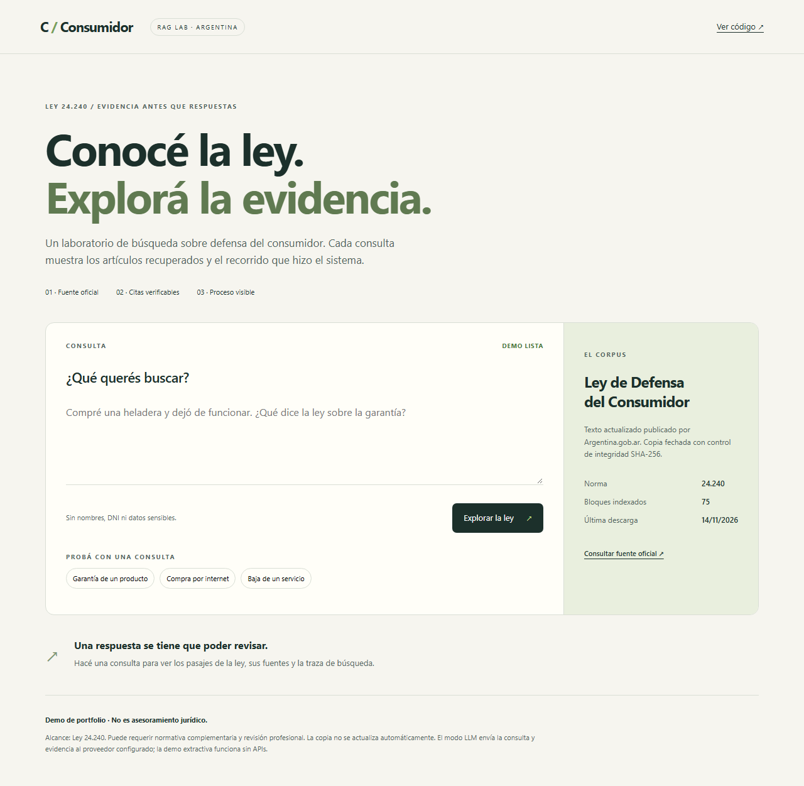
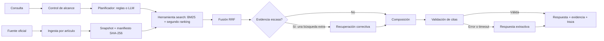

# Consumidor RAG · Argentina

[English documentation](README.en.md) · Español

[](https://github.com/andresListorti/RAG/actions/workflows/ci.yml)

**Búsqueda auditable sobre la Ley 24.240, con citas textuales, recuperación híbrida y un flujo agéntico acotado.**

Proyecto de portfolio para mostrar decisiones de ingeniería de RAG: ingesta reproducible, recuperación evaluable, orquestación con herramientas, generación con evidencia y controles de seguridad. Interfaz y respuestas en español argentino; código en Python.



**Validación real:** 24 tests Python, 12 tests de Chromium en escritorio/móvil, auditorías axe sin infracciones, encoder multilingüe ejecutado y pruebas con Ollama real. Ver [evidencia, resultados y límites](docs/validation.md).

> Demo educativa, no asesoramiento jurídico. La Ley 24.240 es parte de un sistema normativo más amplio. El corpus no incluye jurisprudencia, códigos, reglamentación ni procedimientos provinciales. Verificá siempre la fuente oficial y su vigencia.

## Ejecutar en dos minutos

Requisitos: Python 3.13 y [uv](https://docs.astral.sh/uv/). No hace falta clave ni descargar modelos para la demo predeterminada.

```bash
git clone https://github.com/andresListorti/RAG.git
cd RAG
uv sync --frozen
uv run uvicorn consumidor.api:app --app-dir src --host 127.0.0.1 --port 8000
```

Abrí **http://127.0.0.1:8000**. El snapshot del corpus ya está versionado. La primera instalación necesita internet; la demo extractiva luego funciona sin APIs externas.

```bash
curl http://127.0.0.1:8000/health
curl -X POST http://127.0.0.1:8000/api/ask \
  -H 'Content-Type: application/json' \
  -d '{"question":"¿Qué garantía legal tiene un producto nuevo?"}'
```

En PowerShell:

```powershell
Invoke-RestMethod http://127.0.0.1:8000/api/ask -Method Post -ContentType 'application/json; charset=utf-8' -Body '{"question":"¿Qué garantía legal tiene un producto nuevo?"}'
```

## Qué demuestra

| Capacidad | Implementación |
|---|---|
| Ingesta trazable | Fuente oficial allowlisted, fecha UTC, SHA-256 del HTML y del corpus, validación estructural |
| Chunking legal | Un bloque por artículo, conservando bis/ter/quáter y notas de modificaciones |
| Recuperación híbrida | BM25 + TF-IDF de caracteres; opción BM25 + embeddings multilingües |
| Ranking | Reciprocal Rank Fusion, búsqueda explícita por artículo y fusión de consultas |
| Flujo agéntico | Planificador → herramienta de búsqueda → recuperación correctiva limitada → composición → validación |
| Grounding | Selección de IDs de pasajes permitidos; el servidor recupera la cita original |
| Observabilidad | Pasos y consultas ejecutadas, IDs recuperados, modo, backend, latencia y versión del corpus |
| Evaluación | Dataset versionado, Hit@5, MRR@5, abstención y tests automatizados |
| Seguridad | Sin herramientas de ejecución, sin navegación libre, secretos por entorno, límites y salida DOM segura |

## Arquitectura



La demo sin claves utiliza planificación por reglas y fragmentos textuales. **Ese modo es un baseline de recuperación y composición extractiva, no una demostración de razonamiento de un LLM.** En modo LLM, el modelo selecciona consultas y redacta explicaciones; el código controla las herramientas y los presupuestos. No se usa un framework de agentes: el grafo pequeño es explícito y testeable.

Límites por consulta: hasta 3 búsquedas planificadas, una búsqueda correctiva, 5 artículos, 2 llamadas LLM de hasta 1.500 tokens de salida y timeout de 25 segundos por llamada. Las trazas son registros de acciones, no cadenas privadas de razonamiento.

## Modos de ejecución

### 1. Baseline sin claves (predeterminado)

BM25 + TF-IDF de caracteres con n-gramas 3–5 y RRF. Ambos componentes son **léxicos**: no se presentan como embeddings semánticos. La respuesta contiene pasajes recuperados, no una opinión jurídica generada.

### 2. Embeddings multilingües opcionales

```bash
uv sync --frozen --extra semantic
# Linux/macOS:
export EMBEDDING_MODEL=sentence-transformers/paraphrase-multilingual-MiniLM-L12-v2
# PowerShell:
$env:EMBEDDING_MODEL='sentence-transformers/paraphrase-multilingual-MiniLM-L12-v2'
```

Usá `uv run --extra semantic` para ejecutar el servidor con embeddings y conservar la dependencia opcional. Configurá también `EMBEDDING_REVISION=e8f8c211226b894fcb81acc59f3b34ba3efd5f42`, la revisión probada de este modelo. Se codifican **214 ventanas de 96 tokens con paso 64**, agregadas por máxima similitud al artículo padre: así no se trunca cada artículo a los 128 tokens del encoder. BM25 ve el texto completo. La primera ejecución descarga el modelo; `trust_remote_code=False`. Revisá licencia y procedencia antes de cambiarlo. El índice vive en memoria; para este corpus no hace falta una base vectorial externa.

### 3. Planificación y generación con LLM

Configurá un proveedor compatible con Chat Completions y `response_format=json_object`:

```powershell
$env:GENERATION_BACKEND='llm'
$env:LLM_BASE_URL='https://api.openai.com/v1'
$env:LLM_MODEL='<modelo-disponible-en-tu-proveedor>'
$env:LLM_API_KEY='<tu-clave>'
uv run uvicorn consumidor.api:app --app-dir src --host 127.0.0.1 --port 8000
```

En bash usá `export NOMBRE=valor`. `.env.example` es una referencia; **no se carga automáticamente**. Nunca pegues claves en archivos versionados. El frontend no recibe la clave. Este modo envía pregunta y evidencia al proveedor configurado y puede generar costos. No ingreses información personal.

El generador selecciona `quote_id` de un catálogo de pasajes y redacta una explicación. El servidor recupera el texto original por ese ID: el modelo no necesita copiar la cita. Un ID inventado, plan inválido o timeout produce evidencia extractiva con `fallback=true`. Se comprueba **procedencia textual**, no implicación lógica ni calidad jurídica. Se requiere revisión humana. El modo real fue probado con Ollama; no con un proveedor pago.

### 4. Ollama local, sin clave paga

Con Ollama abierto y `qwen3.5:2b` instalado:

```powershell
$env:GENERATION_BACKEND='llm'
$env:LLM_BASE_URL='http://127.0.0.1:11434/v1'
$env:LLM_ALLOW_LOCAL_HTTP='1'
$env:LLM_MODEL='qwen3.5:2b'
$env:LLM_API_KEY='ollama'
$env:LLM_REASONING_EFFORT='none'
uv run uvicorn consumidor.api:app --app-dir src --host 127.0.0.1 --port 8000
```

`ollama` es un valor de compatibilidad, no una credencial privada. HTTP requiere opt-in y solo se permite para las IP `127.0.0.1` y `::1`; los proveedores remotos requieren HTTPS. Para combinar con embeddings, conservá sus variables y agregá `--extra semantic` a `uv run`. Calentá el modelo antes de una demo: la carga inicial puede superar el timeout de 25 segundos y activar el fallback.

## Corpus y actualización

Fuente: [texto actualizado oficial de la Ley 24.240](https://www.argentina.gob.ar/normativa/nacional/ley-24240-638/actualizacion). Snapshot del **14 de noviembre de 2026**, 75 bloques; [manifiesto](data/manifest.json).

El sitio oficial contiene dos artículos numerados 66 y una nota que lo explica: se conservan como `66` y `66 cierre`, con IDs distintos. Se excluyen navegación y antecedentes normativos históricos de la recuperación. Se conservan notas de modificaciones presentes dentro del texto; no se reinterpretan como un historial normativo completo.

Para los módulos CLI, agregá `src` a `PYTHONPATH`:

```powershell
$env:PYTHONPATH='src'
uv run python -m consumidor.ingest
uv run python -m consumidor.evaluate --output evals/latest.json
```

```bash
PYTHONPATH=src uv run python -m consumidor.ingest
PYTHONPATH=src uv run python -m consumidor.evaluate --output evals/latest.json
```

Revisá el diff del corpus y el resultado de evaluación antes de versionar una actualización. La descarga falla si cambia la estructura o hay duplicados inesperados. `data/raw/` se excluye de Git; se publica el corpus normalizado y sus hashes. SHA-256 detecta modificaciones accidentales respecto del manifiesto; no es una firma de autenticidad frente a un atacante que cambie ambos archivos.

## Tests y evaluación

```bash
uv run pytest -q
uv run ruff check src tests
uv run ruff format --check src tests
PYTHONPATH=src uv run python -m consumidor.evaluate --output evals/latest.json
uv run bandit -r src -q
uv run pip-audit
npm ci
npx playwright install chromium
npm run test:e2e
```

En PowerShell configurá `$env:PYTHONPATH='src'` antes del evaluador. La suite cubre integridad del corpus, búsqueda por artículo, grounding de citas, inyección básica, timeouts del proveedor, validación HTTP y rate limiting. Los fallos bloquean CI.

Baseline reproducible en [evals/baseline.json](evals/baseline.json):

| Métrica | Resultado | Muestra |
|---|---:|---:|
| Hit@5 | 1,0000 | 15 consultas con artículo esperado |
| MRR@5 | 0,7889 | Las mismas 15 consultas |
| Abstención fuera de alcance | 1,0000 | 3 consultas negativas |

Hay además 30 casos de desafío y una comparación con el encoder real: [informe de validación](docs/validation.md). Ambos conjuntos son pequeños, escritos para este proyecto y usados durante desarrollo: **no son un test independiente ni permiten afirmar calidad jurídica de producción**. Hit@5 no mide exhaustividad ni corrección de las explicaciones. La latencia depende del hardware y excluye el arranque del índice.

## Seguridad y despliegue

Leé [SECURITY.md](SECURITY.md) para el modelo de amenazas y las limitaciones. El servidor arranca en localhost; esta versión no tiene autenticación y **no está preparada para exponer una API paga directamente a internet**. Para un despliegue público agregá HTTPS, autenticación, límites distribuidos, presupuesto del proveedor y monitoreo sin datos sensibles. No se publica ni despliega automáticamente desde este repositorio.

El contenedor ejecuta el baseline como usuario sin privilegios:

```bash
docker build -t consumidor-rag .
docker run --rm -p 127.0.0.1:8000:8000 consumidor-rag
```

## Recorrido para entrevistas

1. Ejecutar la demo y consultar garantía de un producto.
2. Abrir evidencia y mostrar la fecha del corpus y el texto del artículo 11.
3. Inspeccionar la traza: plan, consultas y rankings fusionados.
4. Consultar algo fuera de alcance y explicar la abstención heurística.
5. Correr tests y evaluación; discutir la diferencia entre recuperar evidencia y validar una afirmación.
6. Leer [decisiones de arquitectura](docs/architecture.md) y [próximas mejoras](docs/roadmap.md).

## Estructura

```text
src/consumidor/    ingesta, recuperación, agente, API y evaluación
web/              interfaz sin frameworks ni scripts de terceros
data/             snapshot oficial normalizado y manifiesto
evals/            dataset y baseline medido
tests/            pruebas funcionales y de seguridad
docs/             decisiones, limitaciones y roadmap
.github/          CI y revisión de dependencias
```

## Licencia

Código bajo [MIT](LICENSE). El texto normativo se atribuye a la fuente oficial y no se presenta como contenido propio; ver [data/README.md](data/README.md). Sin afiliación con organismos públicos.
